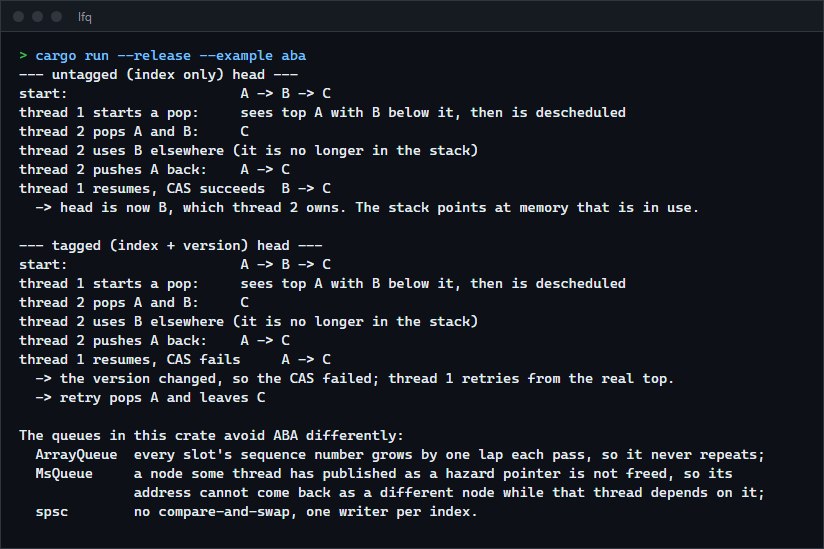
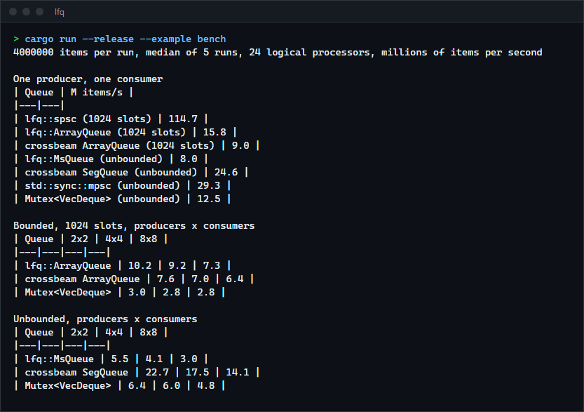
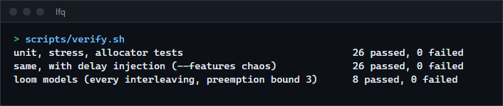

# lfq

Three lock-free queues in Rust with every atomic ordering explained in the source and checked with loom: a single-producer ring buffer, a bounded multi-producer queue and an unbounded multi-producer queue that reclaims memory with hazard pointers. For anyone learning how lock-free code is written and tested, or who wants a small queue to read before reading a large one.

**Status:** v0.1.0, working and tested on Windows x86-64. The library is compile-checked for Linux (musl) and not run there. Not published to crates.io.



## The queues

| Queue | Threads | Capacity | Reclamation | Technique |
|---|---|---|---|---|
| `spsc::channel` | one producer, one consumer | bounded | none needed | Lamport ring, one writer per index, cached copy of the other side's index |
| `ArrayQueue` | any number of each | bounded | none needed | Vyukov: a sequence number per slot says whose turn it is |
| `MsQueue` | any number of each | unbounded | hazard pointers | Michael-Scott linked list with a dummy head node |

How each avoids the ABA problem (a stale compare-and-swap succeeding because an address or value came back):

| Queue | Why ABA cannot happen |
|---|---|
| `spsc` | No compare-and-swap. Each index has one writer. |
| `ArrayQueue` | A slot's sequence number grows by one lap per pass and never repeats on a 64-bit target. |
| `MsQueue` | A node a thread has published as a hazard pointer is not freed, so its address cannot be reused as a different node while that thread depends on it. |

`cargo run --release --example aba` replays the classic schedule on a small stack, first with a plain index in the head and then with a version tag, and prints what each does.

## How to install

Requires a recent stable Rust (built and tested with 1.98.1). Not on crates.io; use it as a git dependency:

```toml
[dependencies]
lfq = { git = "https://github.com/r3clusionn/lock-free-queue" }
```

No dependencies of its own. Optional cargo feature `chaos` (see Verification) is for testing the crate itself.

## How to use

```rust
use lfq::{spsc, ArrayQueue, MsQueue};
use std::sync::Arc;

// One producer thread, one consumer thread. The two halves are not Clone.
let (mut tx, mut rx) = spsc::channel::<u64>(1024);
std::thread::spawn(move || { while tx.push(7).is_err() {} });
let v = loop { if let Some(v) = rx.pop() { break v } };

// Bounded, shared by any number of threads. `push` hands the item back when full.
let q = Arc::new(ArrayQueue::new(1024));
q.push(1).unwrap();
assert_eq!(q.pop(), Some(1));

// Unbounded: `push` never fails.
let q = Arc::new(MsQueue::new());
q.push("hello");
assert_eq!(q.pop(), Some("hello"));
```

| Method | Meaning |
|---|---|
| `push(v)` | `spsc` and `ArrayQueue`: `Result<(), T>`, `Err(v)` when full. `MsQueue`: always succeeds. |
| `pop()` | `Option<T>`, `None` when empty. Never blocks. |
| `capacity()` | Items it can hold. Requested capacity is rounded up to a power of two (minimum 2). |
| `len()`, `is_empty()` | Estimates under concurrency, exact when no other thread is using the queue. `MsQueue` has `is_empty` only. |

Dropping a queue drops the items still in it, once each. Items must be `Send`.

## Benchmarks

Windows 11, Intel Core i9-14900KF (24 logical processors), Rust 1.98.1, release build with LTO (`cargo run --release --example bench`). Each cell is the median of 5 runs of 4,000,000 `u64` items, in millions of items per second (higher is better). Threads are not pinned and spin when the queue is full or empty. The clock runs from the moment all threads are released until the last item is taken out. Comparisons use crossbeam-queue 0.3 and the standard library.



One producer, one consumer:

| Queue | M items/s |
|---|---|
| `lfq::spsc` (1024 slots) | 114.7 |
| `lfq::ArrayQueue` (1024 slots) | 15.8 |
| crossbeam `ArrayQueue` (1024 slots) | 9.0 |
| `lfq::MsQueue` | 8.0 |
| crossbeam `SegQueue` | 24.6 |
| `std::sync::mpsc` | 29.3 |
| `Mutex<VecDeque>` | 12.5 |

Producers x consumers:

| Queue | 2x2 | 4x4 | 8x8 |
|---|---|---|---|
| `lfq::ArrayQueue` (1024 slots) | 10.2 | 9.2 | 7.3 |
| crossbeam `ArrayQueue` (1024 slots) | 7.6 | 7.0 | 6.4 |
| `Mutex<VecDeque>` (bounded to 1024) | 3.0 | 2.8 | 2.8 |
| `lfq::MsQueue` | 5.5 | 4.1 | 3.0 |
| crossbeam `SegQueue` | 22.7 | 17.5 | 14.1 |
| `Mutex<VecDeque>` (unbounded) | 6.4 | 6.0 | 4.8 |

What the numbers say:

- **`spsc` is far ahead** because a single-writer index needs no atomic read-modify-write and, with the cached index, usually touches no cache line the other thread is writing.
- **`ArrayQueue` is ahead of crossbeam's `ArrayQueue` here and 2.6 to 3.4 times ahead of a mutex.** crossbeam's does more (any capacity, `force_push`), so this is a comparison of designs, not a verdict.
- **`MsQueue` is slower than `SegQueue` and, in one-to-one, slower than a mutex.** It allocates one node per item. As a check, passing boxed items through `spsc` (allocate on one thread, free on the other, nothing else) reaches only about 6 million items per second on this machine, so allocation alone puts the ceiling near `MsQueue`'s 8. `SegQueue` allocates one block per 31 items. A node pool would close most of the gap; this crate does not have one.
- Not measured: latency, memory use, other hardware, thread pinning, a many-core server.

## Verification

`scripts/verify.sh` runs everything below: 26 tests in the normal build (16 unit, 1 doctest, 9 integration), the same with delay injection, and 8 loom models.



| Check | What it covers |
|---|---|
| Unit tests (16) and the doctest | FIFO order, full and empty, wrap-around, indices and tickets crossing `usize::MAX`, items dropped exactly once, zero-sized items, rounding of capacity. |
| `tests/stress.rs` | Up to 16 producers and 16 consumers on real threads. Every item must arrive exactly once, in order per producer, uncorrupted; every thread also pushes and pops in a mixed run. |
| `tests/reuse.rs` | The same checks under an allocator that hands a freed block straight back to the next allocation, to provoke ABA. |
| `tests/guard_pages.rs` (Windows) | The same checks under an allocator that gives each block its own page and decommits it on free, so any read of freed memory is an access violation. |
| `tests/loom.rs` | 8 models (producer and consumer, two producers, two consumers racing for one item, a pop racing a push on an empty queue) under every interleaving up to 3 preemptions, with loom's atomics and cells. Run with `RUSTFLAGS="--cfg loom"`. |
| `--features chaos` | Injects yields and short sleeps in the gaps between an atomic operation and the use of what it returned, so the allocator tests meet rare interleavings. |

Why three kinds of check: loom explores thread interleavings but does not model freed memory. A poisoning allocator that never reuses addresses cannot show ABA, and stale reads of freed memory are discarded by the validation step, so it passed even with reclamation switched off. Page-faulting memory catches the read, address reuse catches ABA, and delay injection makes both likely to happen.

Mutation checks (break one thing, confirm a test fails):

| Broken on purpose | Caught by |
|---|---|
| Any one of the four release or acquire operations in `spsc` made `Relaxed` | loom |
| Any one of the four release or acquire operations on slot sequence numbers in `ArrayQueue` made `Relaxed` | loom |
| `MsQueue::pop` does not help a lagging tail | loom |
| A losing `pop` drops its copy of the value instead of forgetting it | loom |
| Retired nodes freed at once | `reuse`, `guard_pages` |
| Scan frees nodes even when a hazard slot holds them | allocator tests with `chaos` |
| `protect` skips the re-check after publishing | allocator tests with `chaos` |
| `pop` skips the re-check of `head` after protecting `next` | allocator tests with `chaos` |
| `pop` does not protect `next` | allocator tests with `chaos` |

Mutants that survive, and why:

- Weakening the link compare-and-swap, the load of `next` or the head compare-and-swap in `MsQueue` to `Relaxed`: the `SeqCst` fences in the hazard-pointer code already order those accesses, so the weaker explicit ordering is not observable. The stronger ordering is kept so each line is correct on its own.
- Removing a `SeqCst` fence in the hazard-pointer code: nothing fails on x86-64, where the fence adds nothing the neighbouring locked instructions do not already give. That ordering is argued in the source, not tested; it would need weakly ordered hardware such as ARM to observe.
- `MsQueue::push` not helping a lagging tail: this costs progress, not correctness (a pusher would wait for the stalled one), and loom checks safety, not liveness.
- Handing a hazard record over with `Relaxed`: no model has two threads reuse a record without a `join` in between, which already orders them.

## How it works

- **`spsc`** (`src/spsc.rs`). The producer owns `tail`, the consumer owns `head`. The producer writes the slot and then stores `tail` with `Release`; the consumer's `Acquire` load of `tail` sees the slot. The consumer frees a slot the same way through `head`. Each side caches the other's index and reloads it only when the cache says full or empty.
- **`ArrayQueue`** (`src/array_queue.rs`). Slot `i` holds a sequence number: equal to the ticket means a producer may fill it, ticket plus one means a consumer may empty it, and a consumer sets it to ticket plus capacity for the next lap. Tickets are claimed by compare-and-swap on `tail` or `head` with `Relaxed` ordering (the data is guarded by the sequence number, not the counter) and the slot is published with a `Release` store.
- **`MsQueue`** (`src/ms_queue.rs`). Linking a node with a compare-and-swap on the last node's `next` is the point where `push` takes effect. Anyone who finds the tail behind helps move it, so no thread waits on another. `pop` copies the value out of the node after the dummy, then swings `head`; the winner owns the value and retires the old dummy, a loser forgets its copy.
- **Hazard pointers** (`src/hazard.rs`). Each operation claims a record with two hazard slots. A thread publishes a pointer, fences, and re-checks that it is still current before using it. Unlinked nodes go on the record's retired list; when the list is long enough the owner scans every hazard slot and frees the nodes nobody holds.
- **Padding.** Counters written by different threads are 128 bytes apart so they do not share a cache line.

## Limits

- `MsQueue` allocates a node per item. Throughput on this machine is bounded by that (see Benchmarks).
- `ArrayQueue` can report full while a pop that has already claimed a slot has not finished with it, and empty in the mirror case. It is the known property of this design, not a bug; callers that must not lose that race retry, as the tests do.
- Capacity is rounded up to a power of two. On a 32-bit target a thread stalled for 2^32 operations could defeat the sequence-number argument.
- Retired nodes wait on the record of the thread that retired them. If such a thread stops using the queue for good, up to `max(16, 4 x records)` nodes stay allocated on that record until the queue is dropped.
- Only Windows x86-64 was run. The ordering arguments are written for the C++ memory model, but nothing was run on ARM.
- A queue is not closeable and has no blocking operations, `len` on `MsQueue`, iterators or async support.

## License

MIT (see `LICENSE`).
